<div align="center">

# Shoe Forge

**Design a sneaker part by part, in real-time 3D, in the browser.**

Pick a classic, click any panel, give it a real material and a color, print your own graphic on it,
and leave with a share link, a saved design, a high-resolution render or the 3D model itself.

[Live site](https://shoe-forge.vercel.app) · [The lineup](https://shoe-forge.vercel.app/shoes) · [Open the studio](https://shoe-forge.vercel.app/studio/air-jordan-1)


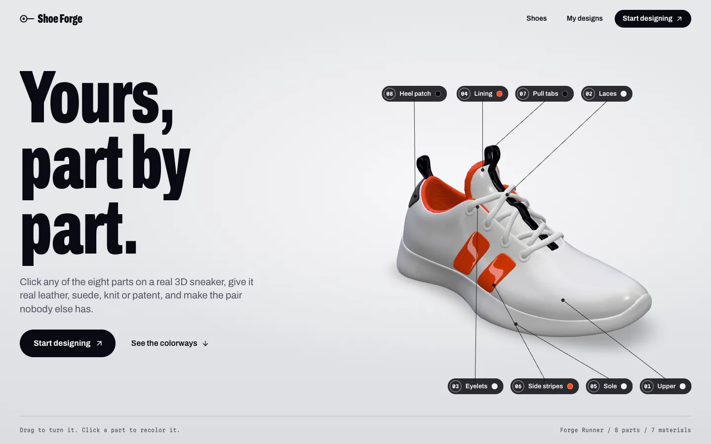

</div>

## Contents

- [Overview](#overview)
- [Features](#features)
- [The lineup](#the-lineup)
- [Screenshots](#screenshots)
- [Architecture](#architecture)
- [How the recoloring works](#how-the-recoloring-works)
- [Tech stack](#tech-stack)
- [Getting started](#getting-started)
- [Scripts](#scripts)
- [Adding a shoe](#adding-a-shoe)
- [Project structure](#project-structure)
- [Testing and CI](#testing-and-ci)
- [Credits and licenses](#credits-and-licenses)

## Overview

Shoe Forge is a sneaker configurator in the spirit of Nike By You, built as a side project. It
renders eight shoes in real time with physically based materials, lets you restyle every part,
and keeps everything in the browser: there is no account, no backend database and no checkout.
A whole design fits in a URL.

Two kinds of 3D models live side by side:

- **Built models** (the original Forge Runner) are split into one mesh per part, each with its
  own material that the studio drives directly with tiled PBR textures.
- **Brand models** (Air Force 1, Jordan 1, Dunk and the rest) are single textured models from
  Sketchfab. Their parts are either separate materials or color regions of the texture, and a
  custom shader recolors them in place while keeping the original stitching, grain and shading.

## Features

### Studio

- **Part-by-part editing.** Click a part on the shoe or in the parts list. The camera turns to
  the side that part faces (underneath for outsoles) and a callout labels it.
- **Seven real materials.** Leather, suede, knit, mesh, canvas, rubber and patent, each with its
  own roughness, sheen and clearcoat. Every part allows only the materials that make sense for it.
- **Named colors.** Brand shoes use an 18-color palette with real names (University Red, Game
  Royal, Wheat), plus a custom color picker and recently used colors.
- **Finish controls.** Fine-tune roughness and fabric sheen per part.
- **Researched colorways.** Every brand shoe ships with presets based on real releases, such as
  Bred Toe, Panda, Syracuse, Flax, Collegiate Green and Optical White. A "Surprise me" button
  generates a harmonious random colorway.
- **Graphics on the surface.** Place one of 24 original marks, upload your own image or type up to
  12 letters, then drag it along the surface. Graphics are projected decals that wrap the shoe.
- **Six camera views and four lighting setups.** 3/4, side, front, back, top and sole; studio,
  daylight, sunset and night.
- **Undo and redo** for every change, including drags as a single step.
- **Command menu and keyboard shortcuts** (see below).
- **Shoe switcher.** Change shoes from the studio header without leaving the studio.
- **Light and dark themes.**

### Saving and sharing

- **Share links.** The full design is compressed into the URL (`?d=`), so any link rebuilds the
  exact pair. Links are validated with a schema before loading.
- **My designs.** Saved designs live in the browser (IndexedDB) with thumbnails, and can be
  renamed, duplicated and deleted.
- **Exports.** Download a PNG at up to 2x resolution, optionally with a transparent background,
  or the 3D model as a `.glb` with your colors baked in.
- **Social cards.** Every shared design gets a generated Open Graph image.

### Home page

- **Intro loader.** A line drawing of the shoe fills as the 3D model downloads and compiles,
  then lifts to reveal the hero, so the page never shows a half-loaded model.
- **Scroll-driven 3D.** One fixed WebGL canvas follows the page: a live hero you can turn and
  recolor, a part-by-part build tour, a material swatch book, colorways and the lineup.
- **Reduced motion** is respected everywhere.

### Keyboard shortcuts

| Keys | Action |
|---|---|
| `Cmd/Ctrl` `K` | Command menu |
| `Cmd/Ctrl` `Z` | Undo |
| `Cmd/Ctrl` `Shift` `Z` | Redo |
| `Cmd/Ctrl` `S` | Save design |
| `[` and `]` | Previous and next part |
| `1` to `6` | Camera views |
| `R` | Surprise colorway |
| `Space` | Turntable on or off |
| `Delete` | Remove the selected graphic |
| `Esc` | Cancel placing or deselect |
| `?` | Show all shortcuts |

## The lineup

| | Shoe | Brand | Category | Parts | Model type |
|---|---|---|---|---|---|
| 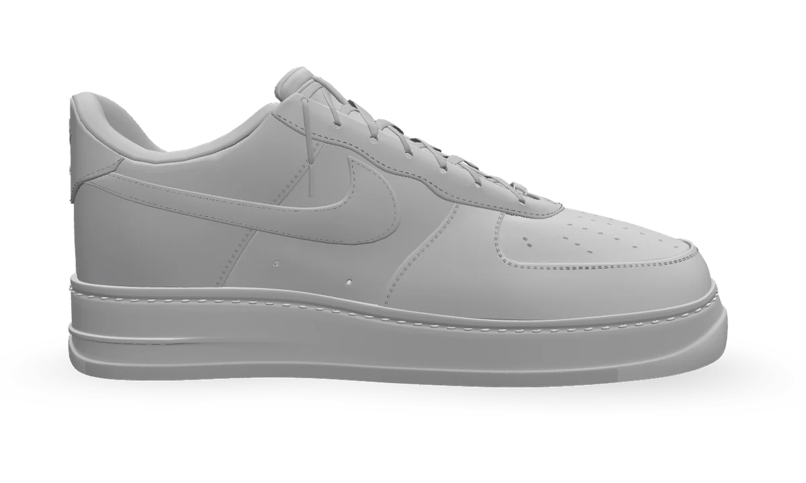 | Air Force 1 '07 | Nike | Basketball | 12 | CG, one material per part |
| 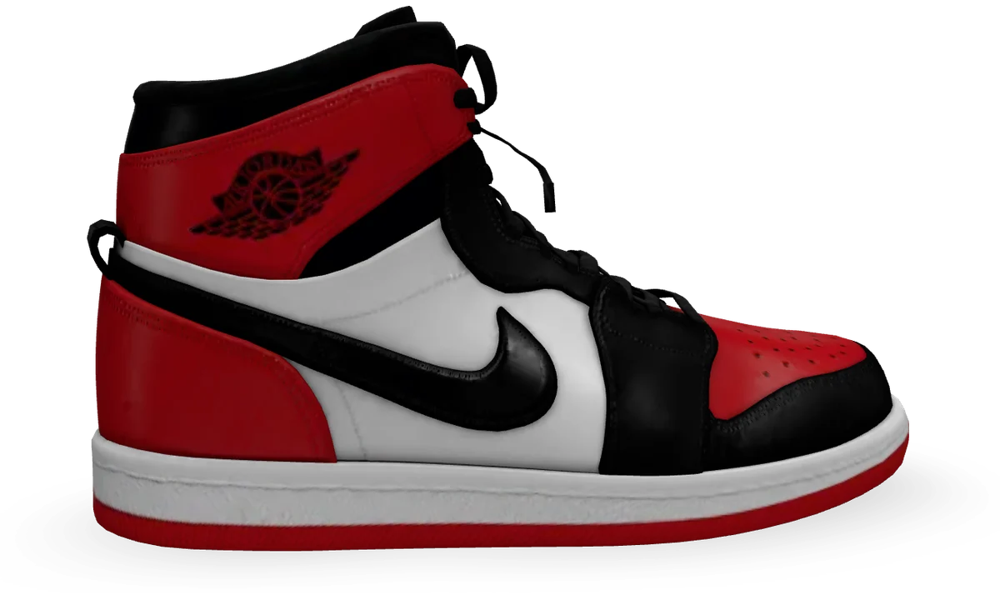 | Air Jordan 1 High | Jordan | Basketball | 7 | Photo scan, color regions |
| 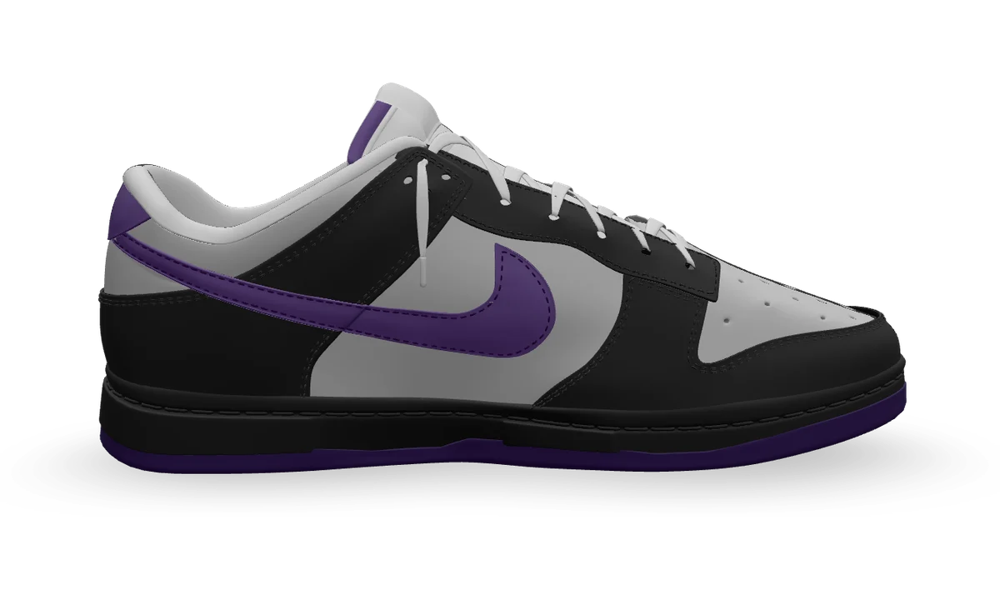 | Dunk Low | Nike | Court | 10 | CG, one material per part |
| 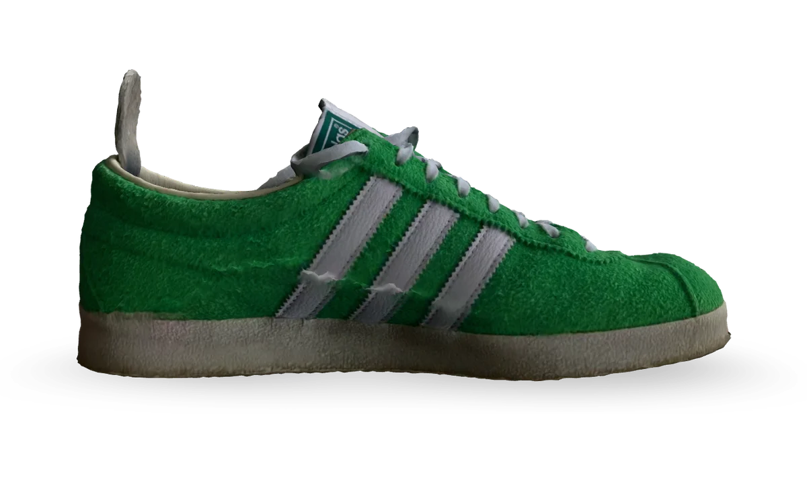 | Gazelle | adidas | Terrace | 4 | Photo scan, color regions |
| 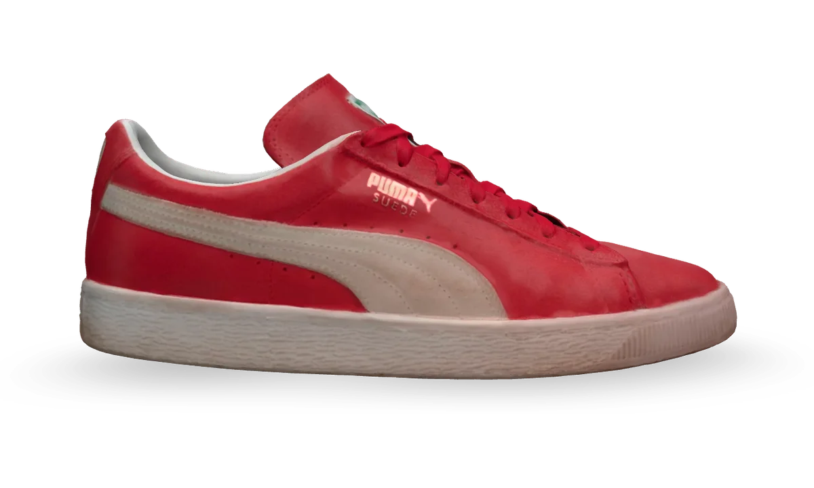 | Suede Classic | PUMA | Court | 5 | Photo scan, color regions |
| 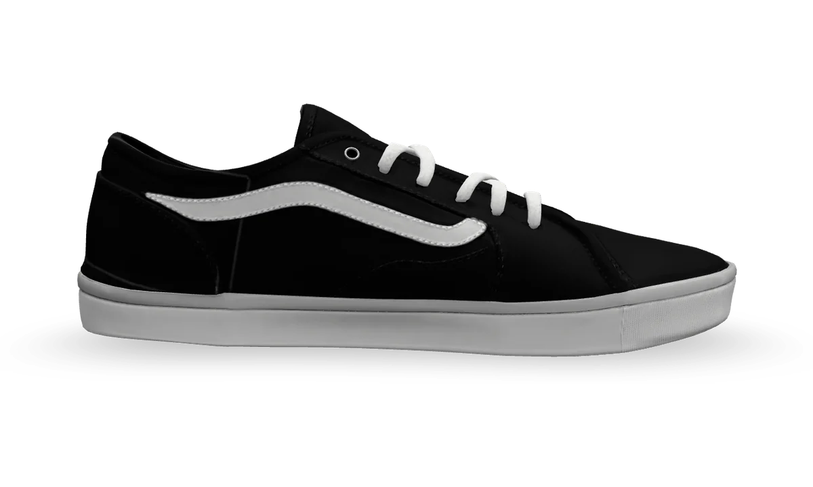 | Old Skool | Vans | Skate | 8 | CG mockup, UV-island regions |
| 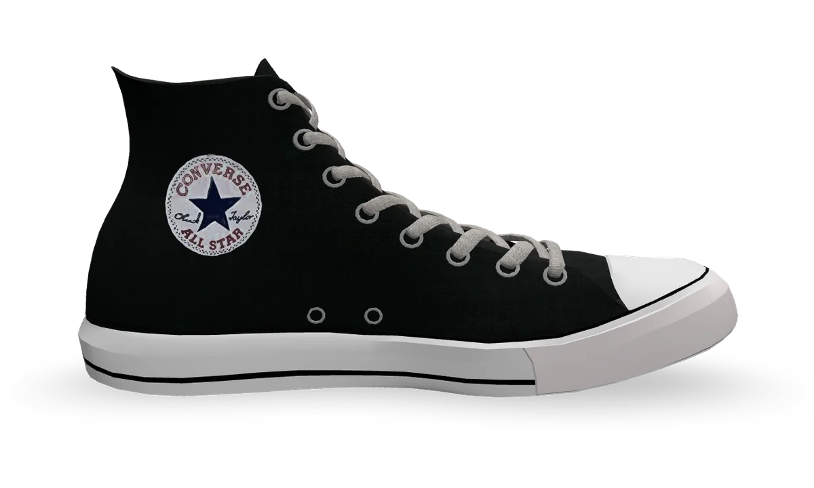 | Chuck Taylor All Star High | Converse | Canvas | 8 | Photo scan, one material per part |
| 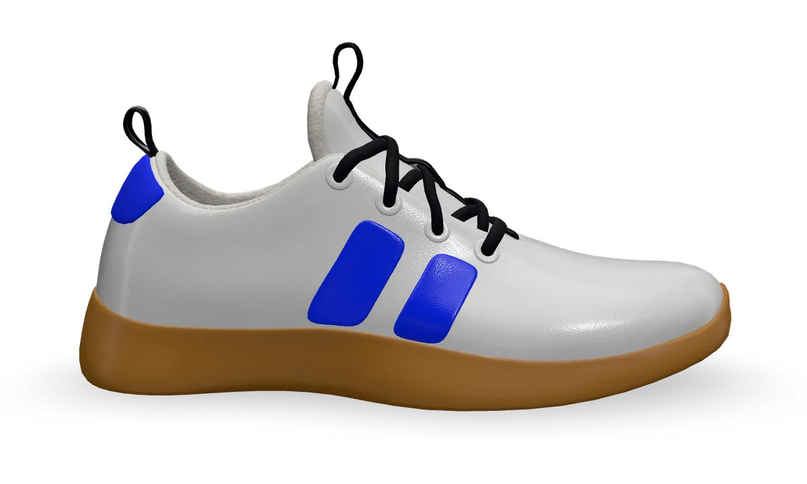 | Forge Runner | Shoe Forge | Running | 8 | Built, one mesh per part |

## Screenshots

| Studio | Shoe switcher |
|---|---|
| 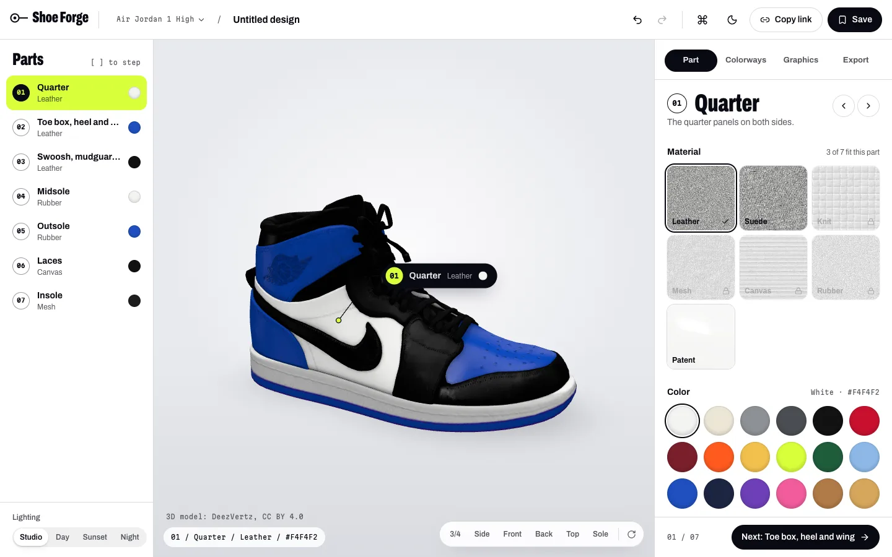 | 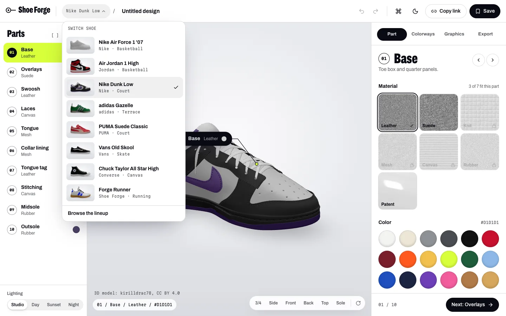 |

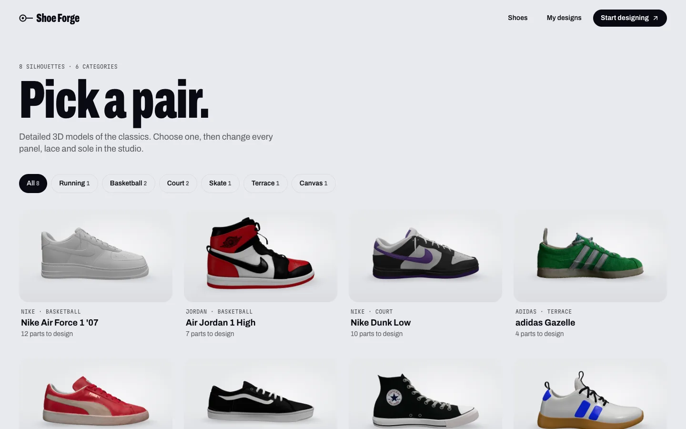

## Architecture

The app is a static Next.js site with no server state. Everything a design needs travels in the
URL or lives in the browser.

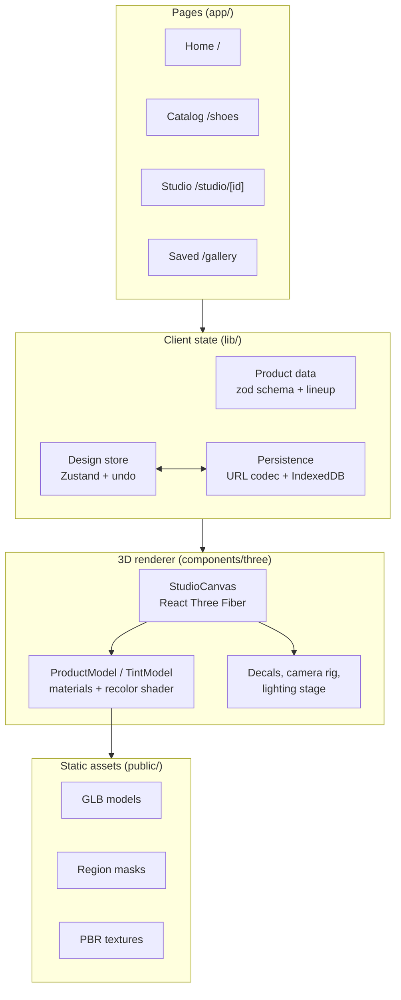

The asset pipeline runs offline and commits its output, so the deployed site only serves static
files:

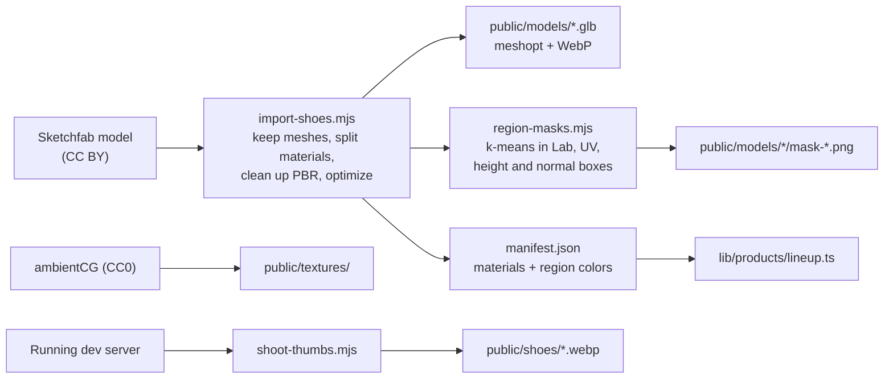

### Request flow in the studio

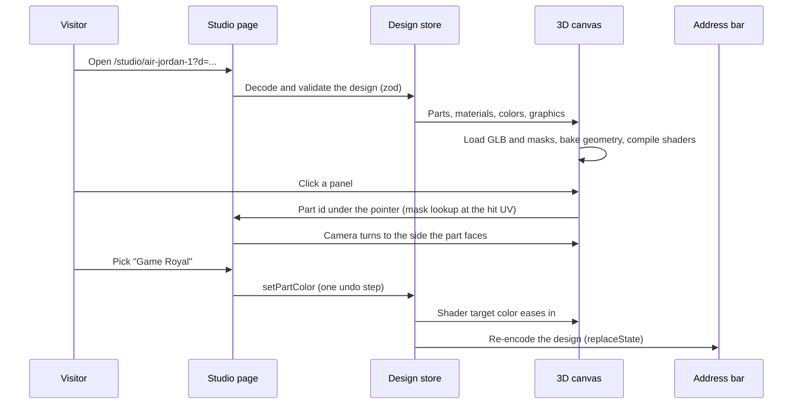

## How the recoloring works

Most brand models are a single mesh with one photographic texture, so "the Swoosh" is not a
separate object. Shoe Forge makes those parts editable without repainting the texture.

1. **Region masks (build time).** `scripts/region-masks.mjs` clusters the texture's colors in Lab
   space (k-means), merges clusters into the parts you would actually customize, and cleans up scan
   noise with a majority filter and island removal. When color alone is not enough, it splits
   regions by UV rectangles, by height on the shoe or by surface direction, using a map baked by
   `scripts/uv-attributes.mjs`. The result is a few soft RGB mask textures per material.
2. **Recolor shader (run time).** `components/three/TintModel.tsx` injects a fragment shader into
   three.js's physical material. For each region it compares the texture's brightness with the
   region's original average and applies the new color by ratio (bright sources) or by difference
   (dark sources). That keeps folds, stitching and grain, so black suede can become white suede and
   still look like suede.
3. **Per-region finish.** Roughness, clearcoat (patent) and fabric sheen are mixed in per region,
   so one part can turn glossy while the panel next to it stays matte.
4. **Picking and framing.** Clicks are resolved to a part by reading the masks at the hit UV.
   Each part's average surface direction (`lib/three/facing.ts`) tells the camera where to look
   from.

CG models with one material per part skip the masks and recolor whole materials with the same
shader.

## Tech stack

| Area | Choice |
|---|---|
| Framework | Next.js 16 (App Router), React 19, TypeScript in strict mode |
| 3D | three.js 0.186, React Three Fiber 9, drei 10 |
| Motion | GSAP 3 with ScrollTrigger, Lenis smooth scroll, Motion |
| Styling | Tailwind CSS 4 with design tokens, Archivo and Martian Mono |
| State | Zustand with zundo (undo/redo) and Immer |
| Validation | zod schemas for products and shared designs |
| Persistence | URL (lz-string) and IndexedDB (idb-keyval) |
| Asset pipeline | glTF Transform, meshoptimizer, sharp |
| Testing | Vitest, Playwright, axe-core |
| Hosting | Vercel, with Vercel Analytics |

## Getting started

Requirements: Node.js 22 or later and npm.

```bash
git clone https://github.com/hardikverma22/shoe-forge.git
cd shoe-forge
npm install
npm run dev
```

Open http://localhost:3000. The lineup is at `/shoes`, and each shoe's studio at
`/studio/<id>`, for example `/studio/dunk-low`.

All models, masks, textures and thumbnails are committed, so nothing needs to be downloaded to
run the app. A Sketchfab token is only needed to re-import or add brand models:

```bash
cp .env.example .env.local
# then add SKETCHFAB_TOKEN=... to .env.local
```

## Scripts

| Command | What it does |
|---|---|
| `npm run dev` | Development server |
| `npm run build` | Production build |
| `npm start` | Serve the production build |
| `npm run lint` | ESLint |
| `npm run typecheck` | TypeScript, strict mode |
| `npm test` | Unit tests (Vitest) |
| `npm run test:e2e` | End-to-end and accessibility tests (Playwright) |
| `npm run assets:model` | Rebuilds the Forge Runner model from its source glTF |
| `npm run assets:textures` | Re-downloads the CC0 PBR texture sets from ambientCG |
| `node scripts/import-shoes.mjs [id ...]` | Downloads brand models from Sketchfab, cleans and optimizes them, and builds their region masks |
| `node scripts/shoot-thumbs.mjs <url>` | Renders the catalog thumbnails from a running dev server |
| `node scripts/bake-swatches.mjs` | Bakes the lit material swatches used across the site |
| `node scripts/trace-silhouette.mjs <image>` | Traces a shoe render into SVG paths (used by the intro loader) |
| `node scripts/qa/region-map.mjs <url> <out> <id>` | Paints every part a different color and shoots four views, to check part separation |

## Adding a shoe

1. Find a downloadable model on Sketchfab under CC BY. Prefer CG models with one material per part
   over photo scans: scans with fragmented texture layouts cannot be split into clean parts.
2. Add an entry to `scripts/shoes.mjs` with the model's id, which meshes to keep, and the mask
   settings for any textured material.
3. Run `node scripts/import-shoes.mjs <id>`. It writes the optimized model, the masks and a
   `manifest.json` listing materials and region colors.
4. Add the product to `lib/products/lineup.ts`: parts (each a material or a region), allowed
   materials, default colors from the manifest, camera views and researched colorways.
5. Check it with `node scripts/qa/region-map.mjs`, render its thumbnail with
   `scripts/shoot-thumbs.mjs`, and run `npm test`. The lineup test verifies every part against the
   model's manifest and mask files.

## Project structure

```
app/
  page.tsx                 Home page
  shoes/                   Catalog with category filters
  studio/[productId]/      The studio
  gallery/                 Saved designs
  api/og/                  Open Graph share image
  render/[productId]/      Dev-only thumbnail renderer
components/
  three/                   StudioCanvas, ProductModel, TintModel, PartGraphics, CameraRig, Stage
  studio/                  Toolbar, ShoeSwitcher, PartRail, SidePanel and its panels, CommandMenu
  landing/                 Hero, IntroLoader, Tour, Materials, Colorways, Lineup, LandingScene
  catalog/                 ShoeGrid and model credits
  site/, ui/               Header, footer, logo, primitives
lib/
  products/                zod schema, the Forge Runner and the brand lineup
  design/                  Design store, URL codec, rules, colorways, saved designs
  three/                   Layout, anchors, part facing, scene and landing rig state
  materials/               Material presets and texture cache
  graphics/, export/       Text rendering, decal geometry, PNG and GLB export
scripts/                   Asset pipeline and QA helpers
tests/
  unit/                    Vitest: schema, codec, rules, colorways, lineup integrity
  e2e/                     Playwright: landing, studio, catalog, mobile, accessibility
public/
  models/                  Optimized GLB models and region masks
  textures/                PBR texture sets
  shoes/                   Catalog thumbnails
  marks/                   Original graphic marks
```

`PRODUCT.md` holds the product facts the design follows, `DESIGN.md` the design system, and
`docs/DECISIONS.md` records each departure from the original plan with its reason.

## Testing and CI

- **Unit tests** (Vitest) cover the design schema and URL codec, part rules, colorway generation,
  and the integrity of the lineup: every part must point at a real material and region, its
  default color must match the model, and its mask file must exist.
- **End-to-end tests** (Playwright, Chromium) cover the home page and intro loader, recoloring in
  the studio, undo, the command menu, PNG export, graphics placement, the catalog, the shoe
  switcher and phone layouts.
- **Accessibility** is checked with axe-core on every main page, with no serious or critical
  violations allowed.
- **CI** (GitHub Actions) runs lint, typecheck, unit tests, a production build and the end-to-end
  suite on every push and pull request. WebGL runs in software (SwiftShader) on CI runners.
- **Deploys** go to Vercel from `master`, with preview deployments for pull requests.

## Credits and licenses

- **3D models** from Sketchfab, used under their licenses:
  - kirilldrac78: Air Force 1 and Dunk Low (CC BY 4.0)
  - DeezVertz: Air Jordan 1 (CC BY 4.0)
  - kzolozhkov: Gazelle (CC BY 4.0)
  - kanesk06: Old Skool (CC BY 4.0)
  - turbopurr: Chuck Taylor (CC BY 4.0)
  - Toni Escribano Llorente: PUMA Suede (CC BY-NC 4.0). This keeps the project non-commercial.
  - The Forge Runner comes from the original Shoe Forge project; confirm its license before any
    commercial use.
- **Textures** from [ambientCG](https://ambientcg.com), CC0 1.0.
- **Fonts**: Archivo and Martian Mono, SIL Open Font License.
- **Graphic marks** are original to this project.

Shoe Forge is a fan project. It is not affiliated with, sponsored or endorsed by Nike, Jordan,
adidas, PUMA, Vans or Converse. Their names and marks belong to their owners.
